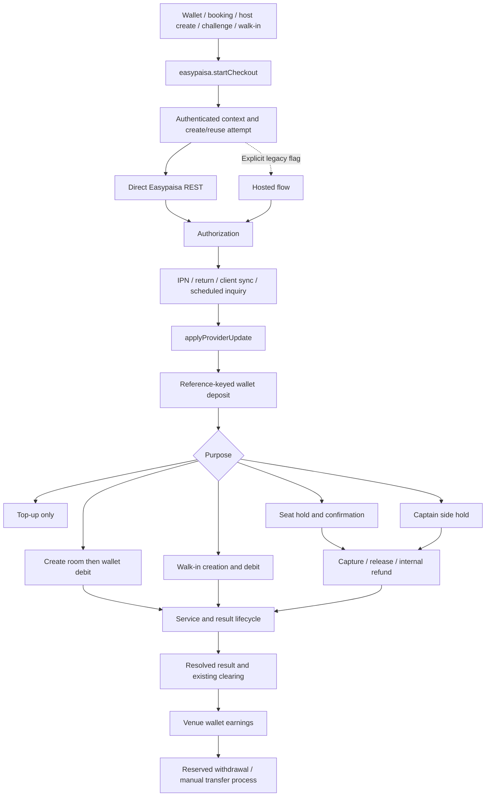

# Complete implementation plan

Source baseline: `ed173e603ed6a9cca9a7a9b934411821bc78f589`. Evidence labels and authority are defined in [00_README.md](00_README.md). No implementation or application testing was performed while preparing these documents.

## 1. Objective and success criteria

Replace the **direct Easypaisa gateway** with a lightweight provider-independent payment service and PayFast Pakistan adapter. Matchhai owns amount/method selection, instructions, QR display, status, recovery, history and refunds in its native mobile interface. Required bank/wallet authorization may occur through approved external applications or secure provider mechanisms.

Success means authenticated external receipts result in exactly-once internal financial processing; correct booking/challenge/venue rules survive; historical records and existing balances remain intact; methods are visible only when documented, entitled and tested; the backend remains efficient at idle and under concurrent journeys. Direct Easypaisa is finally retired in Milestone 08 subject to financial and deployed-client obligations. Production deployment is separate Milestone 09.

Do not equate a WebView with direct native integration. No hosted fallback, undocumented/private checkout endpoint, scraping, card implementation, stored instrument or recurring-billing scope is approved. If native APIs are not permitted, record affected methods, missing permissions, official SDK/component alternatives, security implications and effort; return the architecture exception to the founder.

## 2. Verified repository and stack

The migration and remediation branches both pointed to the expected source SHA during source assessment and documentation setup. There were zero remote branch differences. The latest baseline commit is `fix: resolve qa navigation lists chat and payouts`, September 21, 2026, 13:46:19 UTC. No migration commits occurred after the specified starting commit before this documentation work.

The workspace was empty before authorized cloning. Existing local copies were not authoritative: `D:\matchhai` was on remediation at `043138bfad32e3d79295a0c14d43984d48c30aaf`, with modified `package-lock.json` and untracked `env.download`; `D:\matchhai_app` was on product-ready at `52de8d0b96cd26f5dc495ef5912031c0ce5e1e02`, with modified lockfile and an untracked notification audit document. Leave both workspaces untouched. Do not read potentially sensitive untracked environment downloads into reports.

Declared dependencies: Expo `~54.0.37`, React Native `0.81.5`, React `19.1.0`, Expo Router `~6.0.23`, TypeScript `~5.9.2`, Convex `^1.32.0`, Better Auth `1.6.30`, `@convex-dev/better-auth` `0.12.5`, Zustand `^5.0.8`. QR SVG rendering already exists. Jest, React Native Testing Library, Vitest, convex-test, Maestro and k6 are declared. These are manifest facts, not an installed-version or test result claim.

`app.json` declares scheme `matchhai`, iOS/Android identifier `com.ovaisto.matchhai`, new architecture enabled. Preserve package IDs, signing, EAS ownership and production profiles. `src/theme.ts` contains the requested gaming colors; Montserrat and Inter tokens exist, but `FONTS.body` is Martel. Use existing Inter tokens for new payment UI without a global typography change.

Assessment covered a 761-file pinned archive and repository-wide dependency searches, plus direct inspection of critical paths and supplied documents. Runtime configuration, live financial records, installed customer versions, merchant permissions, full Git-history secret exposure and actual test/provider outcomes remain unknown. Do not present search coverage as execution coverage.

## 3. Existing workflows to preserve

| Capability | Baseline behavior | Migration preservation |
| --- | --- | --- |
| Player top-up | `wallet_topup`; provider deposit reference `easypaisa:<orderRef>` | Verified receipt credited once, recoverable after app closure |
| Join booking | `booking_intent`; credit then hold/seat confirmation | Owner, KYC, approval, expiry, capacity and participant conflict rules |
| Paid host create | `wallet_topup` plus `providerPayload.checkoutContext.matchroomCreateArgs` | Typed domain intent; once-only create/debit; funds retained if unusable |
| Team challenge | `wallet_topup` plus `teamChallengeHold` metadata | Captain/side, lineup, Team B prerequisites, venue/counter-offer rules |
| Walk-in | `wallet_topup` plus `zoneWalkInCreateArgs` | Zone authorization and legitimate payment modes; close trust gap first |
| Recovery | Inquiry, IPN, old returns, bounded scheduled jobs and optional cron | Separate provider policy, shared claims, no polling storm |
| Cancellation | Hold release/captured refund/internal booking credit | Preserve eligibility; never call wallet credit a gateway refund |
| Venue earnings | Completed room + resolved result + clearing eligibility | Preserve configuration, pilot and rounding |
| Withdrawal | Reserve funds on request; approval consumes reservation; rejection returns it | Preserve current rules and add explicit transfer evidence |
| History/account deletion | Provider/ledger joins, anonymization and active-work preflight | Preserve records, links and financial obligations |

`convex/matchrooms.ts:1595` pays venue wallets only after completion, resolved results and existing clearing (default resolved time plus one day). At lines 1647–1655, configured normal payout defaults to 0.9, pilot payout to 1.0; pilot is evaluated using backend time at payout, with configured overrides and existing rounding. Preserve this rather than hardcoding a universal 90/10 split. `venue_payout:<matchroomId>` protects the credit.

Internal `merchantSettlementStatus="captured"` and `venuePayoutStatus="paid"` do not prove gateway bank settlement or completed bank transfer. New displays/records must distinguish them without rewriting old semantics.

## 4. Implementation sequence

The [milestone tracker](06_MILESTONE_TRACKER.md) is authoritative for task status and acceptance. Testing is continuous, not postponed until Milestone 07.

| Milestone | Work and gate | Incremental data |
| --- | --- | --- |
| 00 | Revalidate workspace/baseline and establish safe local test baseline in the implementation chat | None |
| 01 | Fix reference poisoning, withdrawal KYC, walk-in funding authority, numeric/hold invariants and unsafe projections | No new payment tables required; add only proven minimal indexes |
| 02 | Neutral interfaces, typed intent/attempt, safe mock adapter, receipt application and compatibility readers | `paymentIntents`, `paymentReceipts`, minimal `paymentEvents`; optional attempt fields/indexes |
| 03 | Shared native interface and **complete mocked wallet top-up** with reopen/history recovery | No new business tables |
| 04 | Approved direct adapter and **one complete real sandbox wallet top-up** before expanding methods | Add documented method evidence fields only |
| 05 | Seat, host create, challenge-side and authorized walk-in journeys | Add typed purpose payloads/relationships as each journey is integrated |
| 06 | Refunds, reconciliation, operational admin and settlement matching | `paymentRefunds`; `providerSettlements` and `providerSettlementLines` only when settlement workflow is implemented |
| 07 | Full regression, method UAT, native tests, usage/concurrency evidence | No speculative tables |
| 08 | Final direct Easypaisa retirement and production readiness | Historical fields/readers retained; no destructive contraction |
| 09 | Separately authorized production rollout | Approved additive migration/configuration only |

Do not create all tables or integrate all domains before proving the wallet slice. Missing official contracts isolate Milestone 04 methods; Milestones 01–03 and independent test/operational preparation continue safely. Mock transport is test/local QA-only, carries explicit evidence type, cannot target production and cannot be enabled by the mobile client.

## 5. Native UX and per-method requirements

Create one native route, `app/payments/[paymentIntentId].tsx`, shared by existing entrypoints. Retain legacy booking/status routes and safe redirects for compatible navigation. Display purpose, server amount/currency, method capability, authorization instructions, expiration, reference, status and fulfillment result. Keep Matchhai Wallet where applicable.

Use `#42A5F5`, gaming background `#121212`, cards `#1E1E1E`, border `#333333`, text `#FDFDFD`/`#AAAAAA`; reuse existing spacing, controls, sheets and typography tokens. Add loading/empty/offline/provider-unavailable states, text scaling, keyboard handling, accessible labels and screen-reader announcements. Do not introduce unrelated branding.

Closing a screen means continue later, not cancellation. Resume/cold start resolves owner-scoped server state. Persist only safe intent/reference context locally, never authorization tokens. Deep links navigate and trigger safe status recovery; query parameters cannot assert payment success. Success requires verification and committed application. Payment verified but unavailable booking shows wallet credit and separate fulfillment failure.

### RTP — conditional P0

Create intent → collect **only documented** payer identifier/bank choice → initiate server-side → display approval instructions, reference and expiry → customer approves/rejects using supported mechanism → authenticated callback/inquiry → verified receipt → financial application. Required identifier, bank routing, expiry, cancellation, rejection, late success and reconciliation are unknown until the Raast contract is provided. Do not infer mobile/Raast ID/IBAN/CNIC sufficiency.

### QR — conditional P0

Prefer dynamic provider-generated QR bound to amount/reference. Render supported payload with existing SVG library; validate type/size/reference/expiry. No invented EMV/QR serialization. Use verified backend completion. Under/overpayment and distinct duplicate payments become reconciliation cases with receipt evidence. Offer save/share/import/app switching only if officially supported; never assume every bank can scan its own-device screen. Document supported second-device alternatives. Static QR is not automatic fallback.

### Easypaisa, JazzCash and banks through PayFast — separate conditional P0

For each method independently confirm instrument/issuer discovery, fields, amount rules, request auth, customer authorization, inquiry, expiry, rejection/failure, refund and reconciliation. Do not copy old Easypaisa credentials, hashes, response codes or retry schedule. Prefer issuer-app authorization. OTP entry is conditional on explicit provider account-specific approval; transient only, no logs/persistence/analytics. Never collect banking passwords, wallet PINs or CVVs. Bank flows need issuer-specific rules and a documented customer-IP strategy for mobile/Convex; do not substitute server IP or trust a client IP assertion as authoritative.

Cards are excluded: no card UI, hidden card feature, token storage, recurring payment or card SDK implementation. A future provider-managed secure flow requires separate founder/provider/security approval.

## 6. Financial, admin and refund scope

Implement [architecture invariants](05_ARCHITECTURE.md) and [security fixes](03_SECURITY_FINDINGS.md). Reuse correct wallet/hold/booking functions, not the gateway monolith. Authentication, KYC, captain/zone ownership and server quotes are enforced at actual mutations, not UI/action wrappers alone.

Refunds distinguish internal wallet return, hold release, cancellation credit, original-instrument refund, partial refund, reversal, void and chargeback. Evidence-linked authorized manual workflow remains available when automated APIs are unavailable. Never mark completed on request creation or ambiguous submission. Concurrent pending refunds reserve remaining refundable value. Avoid refunding the same liability twice after wallet credit. Spent/allocated funds need a founder-approved recovery policy; no silent negative balance or zone clawback.

Zone Admin keeps earnings, branch attribution, withdrawal reservation and existing eligibility. Super Admin adds provider/environment/method/purpose/verification filters, safe timeline, linked receipts/ledger/bookings/challenges/refunds/settlements, discrepancy queues and bounded inquiry. No unrestricted manual paid/credit control. Existing admin auth and safe audits remain. Maker/approver separation for manual financial correction is a recommendation pending founder confirmation, not an already authorized policy change.

Settlement matches gross receipts minus confirmed refunds/reversals minus actual fees/taxes plus adjustments to provider statement and bank credit. Do not assume PayFast splits or pays zones. Preserve current withdrawals; quantify working-capital exposure because zone eligibility may precede bank settlement. Settlement-based withdrawal restrictions and fee allocation changes require founder approval.

## 7. Convex performance and monitoring

Preserve existing maintenance flags and one-shot lifecycle improvements. Eliminate two-/five-second provider inquiry loops. Use one scoped reactive status subscription while focused, skipped off-screen; queries never call provider. Resume/manual/callback/admin/scheduler requests share one server claim, minimum inquiry interval and provider-specific bounded retry policy. No duplicate job chains; persist scheduled job identity, cancel superseded jobs, stop terminal processing and escalate exhausted/unknown attempts.

Use indexed cursor pages, bounded joins and aggregates where lifetime financial summaries currently collect growing data. Do not mask correctness by silently truncating histories or reservation conflict searches. Provider-specific maximum age/backoff/expiry require documented policy; preserve legacy Easypaisa policy only for its own workstream. Circuit breakers must stop initiation while preserving accepted-payment recovery.

Measurement protocol: pin dataset/commit/deployment; capture baseline and after idle windows, one complete journey, concurrent journeys, history pages and provider outage. Record function calls, database I/O, compute, bytes, scheduled backlog and external requests. Acceptance: zero idle payment traffic without unresolved work; costs bounded by requested pages and unresolved attempts; no duplicate jobs/credits; terminal retries terminate. Any balance violation, duplicate application or environment mismatch is critical. Backlog alerts use provider-confirmed SLA; cost thresholds use measured baseline and forecast, not arbitrary promises. Existing script's 15,000 daily call tripwire is not a justified new capacity target.

## 8. Platform and compliance

Physical venue services consumed outside the app align with [Apple 3.1.3(e)](https://developer.apple.com/app-store/review/guidelines/#goods-and-services-outside-of-the-app) and [Google Payments physical-service treatment](https://support.google.com/googleplay/android-developer/answer/9858738?hl=en). Do not automatically apply this classification to every wallet use. Separately assess online matchrooms, paid esports participation, real-world prizes and future digital goods under [Google contests policy](https://support.google.com/googleplay/android-developer/answer/9877032?hl=en) and Apple gaming rules. Existing publication does not establish approval of changed flows.

Supplied Merchant terms clauses 3–8 require service descriptions, return/refund/privacy/terms/FAQs, local support contact/permanent address, PKR pricing, branding, fraud/dispute response, delivery evidence and minimum two-year transaction retention. Additional legal holds may extend retention. Wallet/third-party venue/withdrawal classification needs explicit provider/legal confirmation. No legal conclusion or document change is authorized here. The submitted website-address clarification is not a technical blocker; final merchant acceptance is.

Coordinate website workspace changes for disclosures, wallet-credit versus instrument-refund policy, approved branding, service-delivery evidence and app/universal-link association files. Do not modify that workspace in this phase.

Expo Go supports limited component work, not complete validation of native authorization/links/custom SDKs. Use real Android/iOS development/internal builds later; preserve identifiers, auth sessions, signing and ownership. See [Expo linking](https://docs.expo.dev/linking/overview/) and [library compatibility](https://docs.expo.dev/workflow/using-libraries/). Reconfirm SDK54-specific APIs rather than blindly adopting current latest examples.

## 9. Exact future implementation file manifest

These are proposed files, **not files created in this documentation commit**. Create incrementally when used.

### Add

Backend: `convex/payments.ts`, `convex/paymentModel.ts`, `convex/paymentFinancials.ts`, `convex/paymentReconciliation.ts`, `convex/paymentRefunds.ts`, `convex/paymentSettlements.ts`, `convex/payfast.ts`, `convex/payfastConfig.ts`, `convex/payfastContracts.ts`, `convex/payfastHttp.ts`, `convex/paymentMigrations.ts`.

Frontend: `app/payments/[paymentIntentId].tsx`, `src/features/payments/PaymentScreen.tsx`, `PaymentMethodPicker.tsx`, `PaymentInstructions.tsx`, `PaymentStatusPanel.tsx`, `usePaymentIntent.ts`, `types.ts` (all latter files under `src/features/payments/`), and `src/services/convex/paymentService.ts`.

Tests: `__tests__/unit/payfastConfig.test.ts`, `__tests__/unit/payfastContracts.test.ts`, `__tests__/security/paymentBoundaries.test.ts`, `__tests__/ui/PaymentScreen.test.tsx`, `convex-test/paymentFinancials.test.ts`, `convex-test/paymentConcurrency.test.ts`, `convex-test/paymentMigrationCompatibility.test.ts`, `.maestro/10-payfast-payment.yaml`. Keep pure mock fixtures in the existing test fixture tree, never a production-selectable mock success endpoint.

The canonical documentation is the numbered package in this directory. Earlier proposed unnumbered names such as `MIGRATION_PLAN.md`, `PROVIDER_CONTRACTS.md` and `TEST_INVENTORY.md` are superseded by these files; do not create competing copies.

### Modify

Backend: `convex/schema.ts`, `http.ts`, `crons.ts`, `wallet.ts`, `admin.ts`, `matchrooms.ts`, `teamChallenges.ts`, `zoneAdminBooking.ts`, `zoneWallet.ts`, `zoneWithdrawals.ts`, `accountDeletion.ts`, `maintenanceDue.ts`, `notifications.ts`, `protectedDataReset.ts`, `fullDataReset.ts`, `devReset.ts`, `devCleanup.ts`; existing gateway modules only for temporary compatibility/extraction. Reuse `matchroomPricing.ts`, `bookingConflicts.ts`, `authz.ts`, `kycGate.ts`, `zonePilot.ts`; modify only if a traced requirement needs it.

Native screens, shared hooks/styles, services, readiness/error/routing/privacy and test paths are enumerated precisely in [02_DEPENDENCY_INVENTORY.md](02_DEPENDENCY_INVENTORY.md). Preserve old admin route alias. Modify `env/convex.env.example`, `env/app.env.example`, `scripts/convex-qa-usage-snapshot.mjs`, relevant Maestro/CI/release/support docs. Regenerate `convex/_generated/api.d.ts` through approved codegen, never hand-edit it.

Only a confirmed SDK/link requirement may justify `app.json`/`eas.json` edits. No dependency upgrade is implicit in migration or repository guidance; justify changes separately and retain tested versions where possible.

### Retain and remove

Retain old schema/provider values, ledger references, financial records, historical migrations/audits, legacy route alias and required client wrappers. Temporarily retain `convex/easypaisa.ts`, `easypaisaNode.ts`, `easypaisaRest.ts`, `easypaisaConfig.ts`, legacy HTTP routes and inquiry/signing credentials for existing obligations. Final removals are explicitly governed by [09_EASYPAISA_RETIREMENT.md](09_EASYPAISA_RETIREMENT.md), not by grep alone.

## 10. Estimates, blockers and completion

Effort bands in the tracker are relative engineering estimates, not invented hours: Small = localized boundary/UI change; Medium = several functions/one flow; Large = cross-layer accounting/concurrency/regression; Conditional = provider details insufficient to estimate. Numerical schedules need complete contracts and measured team velocity; provider turnaround is excluded.

Independent development is not blocked by missing Raast specs. Provider-connected methods are blocked by missing contract/entitlement/evidence. Production additionally requires P0 security closure, verified receipt binding, native/UAT/regression/usage evidence, client compatibility, outstanding Easypaisa treatment, refund/dispute operations, final terms/classification, rollback rehearsal and explicit deployment approval. See [11_ROLLOUT_AND_ROLLBACK.md](11_ROLLOUT_AND_ROLLBACK.md).

Every implementation phase must report problem/current behavior/root cause/solution/files/risks/tests before editing, and changes/preserved behavior/security/performance/tests/pending tests/risks/branch/SHA/deployment after. Record blocked tests rather than dropping them. No task completes from code alone.
