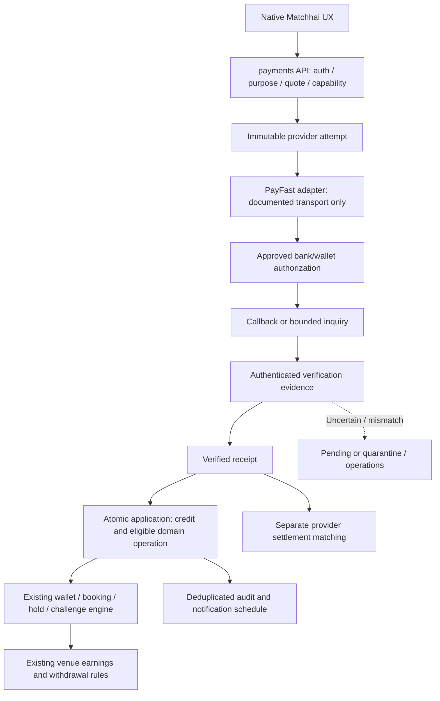

# Payment architecture and financial invariants

**R:** target design; not implemented. Baseline evidence lives in [02_DEPENDENCY_INVENTORY.md](02_DEPENDENCY_INVENTORY.md); P0 fixes in [03_SECURITY_FINDINGS.md](03_SECURITY_FINDINGS.md); provider constraints in [04_PROVIDER_CONTRACTS.md](04_PROVIDER_CONTRACTS.md).

## 1. Layers and trust



Keep Convex as backend. Provider I/O runs in actions; writes run in mutations. A mutation cannot wrap an external debit in its database transaction. Persist an attempt before external I/O, handle uncertain outcomes explicitly and use idempotent application afterward. Reference: [Convex actions](https://docs.convex.dev/functions/actions), [OCC/atomicity](https://docs.convex.dev/database/advanced/occ).

No parallel database/server/queue is justified by default. A fixed-egress/provider constraint must be documented and brought back as a targeted infrastructure decision, not silently worked around.

## 2. Matchhai public contracts

Names below are internal proposals, never PayFast endpoints. Use runtime args/returns validators and generated types. Actor identity comes from existing centralized Better Auth/Convex authorization; public user IDs are not authority. Legacy user-ID fields may remain temporarily but must match authenticated identity.

| Contract | Kind | Input/behavior | Output boundary |
| --- | --- | --- | --- |
| `payments.getCapabilities` | query | Current environment/merchant and purpose eligibility | Enabled methods and stable safe unavailable reasons; no secrets |
| `payments.createIntent` | mutation | Typed purpose + domain identity/draft, customer top-up amount if applicable, stable client request key | Intent ID, immutable quote/version, currency, purpose eligibility/expiry |
| `payments.initiate` | action | Intent ID, enabled method, allowlisted method fields, request identity | Attempt ID and safe next action; no merchant/access/instrument secret |
| `payments.submitAuthorization` | action, conditional | Attempt ID + ephemeral approved authorization | Safe status/next action; never persist raw authorization |
| `payments.getStatus` | query | Owned intent/attempt ID | Separate payment/verification/application/fulfillment states, safe reference and expiry |
| `payments.requestStatusRefresh` | action | Owned attempt ID | Claim or cooldown/recovery result; no force-paid behavior |
| `payments.requestCancellation` | mutation/action | Owned attempt + reason | Cancellation requested versus provider-confirmed cancellation |
| `payments.listMyHistory` | query | Cursor and allowlisted filters | Bounded safe history page |
| Admin payment/refund/review commands | authenticated query/mutation/action | Evidence-linked target and permitted operation | Safe audit result, never unrestricted credit/paid control |

Purpose union: `wallet_topup`, `booking_intent`, `matchroom_create`, `team_challenge_side`, `zone_walkin_create`. Attach exactly one validated purpose. Bind team side/captain/challenge, owner/zone/walk-in, or booking/host context explicitly; do not place arbitrary `v.any()` domain create arguments in provider payloads.

Top-up amounts are customer choices under existing approved limits. All other amounts come from current server domain rules. Reuse `computeAuthoritativeMatchroomPricing`, booking-intent pricing, challenge-side calculation and resource/conflict checks; do not change formulas. Quote is immutable per intent; repricing creates a new version/customer review rather than changing an initiated amount.

Safe `nextAction` variants: `none`, `display_instructions`, `display_qr`, `await_external_authorization`, `submit_provider_authorization`. Implement only variants justified by approved method specifications. Arbitrary HTML/URLs or token blobs are not generic next actions. No card variant in v1.

Native Convex action transport does not automatically establish the end user's network IP. Resolve provider `customer_ip` requirements in contract review. Use an officially approved acquisition mechanism; do not invent a trusted header, substitute backend IP or treat client input as verified. If an authenticated HTTP ingress is needed, document platform provenance and reuse existing auth; gate that adapter until resolved.

## 3. Orthogonal state machines

Legacy `paymentTransactions.status` remains compatible. New dimensions avoid treating provider response, money application, service delivery and bank settlement as the same event.

| Dimension | Proposed internal values/concepts |
| --- | --- |
| Attempt | created; initiating; authorization pending; provider reported paid; failed; expired; cancellation requested; provider cancelled; unknown |
| Verification | unverified; pending; verified; mismatch; manual review |
| Application | unapplied; applied; retry required; quarantined |
| Fulfillment | not applicable; pending; fulfilled; wallet credit only; failed/review |
| Refund | requested; approved; submitted; pending confirmation; completed; failed; unknown |
| Provider settlement | unmatched; expected; reported; bank confirmed; discrepancy |
| Zone withdrawal | existing eligibility/reservation plus explicit bank-transfer evidence |

Registered validators use stable snake_case names matching these concepts when implemented. Provider status/code mapping is isolated and versioned in adapter parsers, not inferred from legacy statuses. Unknown codes cannot mean success.

Allowed lifecycle: create intent → persist/claim attempt → initiate → authorization pending/unknown → authenticated provider outcome → verify receipt → apply finances → fulfill or wallet-credit-only. Failure/expiry/cancel do not destroy a later verifiable money liability. A paid receipt is immutable; authenticated reversal/refund/chargeback is a new linked event, not retroactive deletion.

Customer success requires verified receipt plus committed application. Show received/processing if verification/application remain pending. Separate confirmed booking from successful top-up. A local cancel/closed modal never asserts provider cancellation.

## 4. Required invariants

1. Unique intent identity and stable request fingerprint bind actor, purpose/domain object, amount/currency and environment.
2. One idempotency key reused with different inputs fails. Indexed read-and-insert inside a mutation enforces application uniqueness; Convex indexes alone are not unique constraints.
3. Persist before provider call. Provider idempotency is used only when documented. An accepted-but-timed-out initiation remains unknown; inquire before a new debit-capable attempt.
4. A receipt binds approved merchant/environment, intent/Basket ID, unique provider transaction identity, exact amount, currency and final financial status. Expected local values are comparisons, not provider evidence.
5. Same callback or receipt cannot credit twice, even across refresh/callback/scheduler/admin races. A distinct genuine second receipt is recorded as a separate liability; do not drop real money because purpose was already fulfilled.
6. Ledger idempotency compares owner, type, amount, currency, original operation and source/domain ID. Reference collision with different identity is an anomaly, never a successful no-op.
7. Holds are funded. Capture + release cannot exceed the original hold; refunds cannot exceed confirmed refundable remainder including pending reservations. Negative available or held balances are rejected.
8. Booking/challenge/create fulfillment is exactly once, with current authorization, expiry/capacity/eligibility checks. External reference is accepted only internally with verified receipt linkage.
9. Old attempts clear/expire shared pointers only if they still own them. Attempt expiry cannot cancel a newer successful booking attempt.
10. Provider success, verification, wallet credit, hold, booking confirmation, service delivery, capture, zone earnings, provider bank settlement, withdrawal and refund completion are separate facts.
11. Financial evidence is immutable/audited and historical provider identity preserved. Corrections use linked compensating operations, not deletion or fabricated success.
12. Administrative visibility does not grant unrestricted financial write authority. Every privileged intervention has role, evidence, reason, result and audit.

### Atomic application and recovery

Stage A records authenticated verification evidence and an immutable receipt in a mutation. Stage B applies that receipt in a transactional mutation: check receipt unapplied, operation identity and current domain eligibility; credit wallet and perform eligible hold/create/debit; mark applied and record outcome. Expected domain unavailability is an explicit outcome with wallet credit only. Unexpected system errors roll back financial application; verified evidence remains for bounded recovery. Do not catch arbitrary failures after partial writes and label them successful. Verify actual nested-mutation rollback semantics with behavioral tests rather than relying on comments.

Notifications are scheduled/deduplicated from committed events. Notification delivery failure cannot cause another credit. No provider I/O inside the financial mutation.

| Edge | Behavior |
| --- | --- |
| Success after booking cancellation/expiry | Credit verified funds once; do not revive booking automatically |
| Resource or lineup changed | Revalidate; preserve money as wallet credit if purpose cannot complete |
| Same callback repeated | Deduplicate/audit without another financial application |
| Separate second real payment | Separate receipt/credit or approved correction liability, no repeated fulfillment |
| Out-of-order failure after paid | Preserve paid receipt; require authenticated adjustment event |
| Wrong amount/currency/reference | Quarantine before irreversible application |
| App terminated | Server receipt/application/jobs continue; owner recovers intent on reopen |
| Chargeback after allocation | Evidence-linked discrepancy/recovery case; no automatic negative balance/zone clawback |
| Refund request response lost | Unknown/pending; inquiry/provider operations before resubmission |

## 5. Incremental database design

Do not eagerly create every proposed table. Existing `paymentTransactions` remains the provider-attempt table. Existing `walletTransactions` stays the internal ledger; balances and hold semantics remain current. New tables are justified by distinct lifecycle/retention/read requirements.

| Table / change | First milestone | Minimum responsibility |
| --- | --- | --- |
| Existing wallet/index hardening | 01 | Bound operation identity/authorization; no speculative provider tables |
| `paymentIntents` | 02 | Owner, typed purpose/domain relationship, immutable quote/version, currency, request identity, active attempt and timestamps |
| `paymentReceipts` | 02 | Environment/provider receipt identity, independently verified financial facts/evidence link, once-only application/outcome |
| `paymentEvents` | 02 | Minimal sanitized callback/verification/application audit; append rows rather than unbounded arrays |
| Optional `paymentTransactions` fields | 02, expanded 04/05 | Intent link, provider/environment/method, amount minor units, verification/application/fulfillment and reconciliation state |
| Domain purpose structures | 05 | Booking/create/challenge/walk-in data added when that journey is actually integrated |
| `paymentRefunds` | 06 | Original receipt, approved/requested amount, reserved remainder, submission/confirmation/evidence, actor/reason |
| `providerSettlements` | 06 | Batch/statement, currency, expected/reported/bank-confirmed totals, source evidence |
| `providerSettlementLines` | 06 | Receipt/refund/fee/tax/adjustment matching and discrepancy; no assumed provider API |

All additions to populated tables start optional. Widen provider validation to retain `easypaisa` and add `payfast`. Legacy kinds (`booking_intent`, `wallet_topup`) and statuses remain valid; new purpose records disambiguate historical metadata. Native attempts must not require fake `checkoutToken`, `checkoutUrl` or `appReturnUrl`; make hosted-only requirements conditional/optional compatibly. Missing fields mean legacy/unknown, not verified.

Indexes: actor + idempotency key; intent owner + created time; purpose + domain identity; provider + environment + Basket ID; provider + environment + provider receipt ID; status + next due time; receipt + refund state; settlement line matching key. Include merchant configuration scope where the approved provider uniqueness domain requires it. Every read path has an appropriate index and bounded cursor/page. Do not use unbounded `.collect()` for growing data or silently truncated searches to establish financial correctness.

### Money

New provider comparisons use safe integer PKR minor units; explicit finite/positive/precision/safe-range guards. Preserve approved domain rounding before conversion. No universal float epsilon or `Math.ceil` replacement across historic formulas. Existing numeric ledger/balance records remain. Centralize checked conversion, audit incompatible precision, quarantine discrepancies and seek approval for actual financial correction. Full historic ledger/balance minor-unit conversion is deferred to separately approved migration. Never backfill provider evidence from local amount fields.

### Migration procedure

1. Expand validators/indexes and deploy dual-format readers with provider disabled.
2. Add bounded resumable migration definitions; no destructive import/reset.
3. Backfill only derivable identity/classification fields; record unknowns.
4. Compare counts, sums, references, balances, holds and domain links before/after.
5. Test old records with every new field absent and old clients calling legacy APIs.
6. Enable new writes only after gates; keep old readers/validators for deployed clients.
7. Tighten new-format constraints separately; historical contraction never deletes records.

Rollback leaves expanded schema/records intact and disables new initiation. Code rollback must understand rows already written; never restore an old schema that rejects them. Financial recovery uses audited adjustments.

## 6. Configuration and credentials

Server-only internal proposals: `PAYFAST_ENV`, `PAYFAST_ENABLED`, `PAYFAST_MERCHANT_ID`, `PAYFAST_SECURED_KEY`, `PAYFAST_API_BASE_URL`, `PAYFAST_CALLBACK_BASE_URL`, `PAYFAST_METHOD_CAPABILITIES`. Separate request-signing/webhook keys only when official contract requires them; do not assume merchant secured key is every signing key. Internal signing keys remain distinct.

Fail closed on unknown/missing environment, disabled provider, unsupported method or invalid endpoint. Allowlist approved HTTPS origin/path and redirects; no arbitrary client endpoint. Bind callbacks/receipts/keys to environment and merchant configuration version. Public capabilities expose availability, not credentials. Keep secrets out of `EXPO_PUBLIC`, bundles, DB projections, logs/errors, analytics, screenshots and fixtures. Rotation preserves needed verification for unresolved obligations without silently moving transactions to another merchant.

Migration QA is separate from historically live-enabled remediation QA: synthetic users/balances; no live Easypaisa or PayFast production credentials; mock default; sandbox-only egress policy; environment-bound callbacks; destructive production-target reset disabled; existing KYC/auth bypasses off unless individually documented test necessity. Never run configuration commands against production by assumption.

## 7. Refund, settlement and retention boundaries

Refund intent is not completion. Validate original receipt, confirmed refundable amount, pending reservations, prior wallet returns and spent/allocated funds. Automated API remains conditional; manual evidence-linked workflow uses existing admin authorization with proposed independent approval. Provider confirmation precedes gateway-refund completion. No blanket auto-deduct/clawback policy is approved.

Provider settlements are separate from merchant-capture metadata and venue-wallet earnings. Match actual statements/bank credits and fees/taxes, never infer split settlement or disbursement. Preserve current payout timing; assess liquidity gap before release. A new restriction needs founder approval.

Extend deletion preflight for new pending receipts/refunds/disputes. Retain historical provider identity, payments/ledger/audit and minimum contractual retention (at least two years for supplied Merchant terms), plus legal/dispute holds. Anonymization must preserve required restricted evidence and references; legal scope is unresolved. Production reset tooling must not erase financial history.

## 8. Exact baseline schema compatibility contract

The following is a source snapshot at `ed173e603ed6a9cca9a7a9b934411821bc78f589`, not a schema change or target implementation. It preserves the current status/kind/type enums, required hosted fields, optional payload/evidence/recovery fields and all relevant existing indexes. New writes/readers must accommodate existing rows exactly; proposed additions above are incremental. `walletTransactions` amounts are existing numeric PKR values; no record conversion has been executed. `paymentTransactions` has only Easypaisa as provider and only booking/top-up as kinds; create/challenge/walk-in purposes currently live in metadata.

### `walletTransactions` ? baseline `convex/schema.ts:490`

```typescript
  walletTransactions: defineTable({
    userId: v.id("users"),
    type: v.union(
      v.literal("deposit"),
      v.literal("withdrawal"),
      v.literal("booking_payment"),
      v.literal("refund"),
      v.literal("hold"),
      v.literal("hold_release"),
      v.literal("hold_capture")
    ),
    amount: v.number(),
    status: v.union(
      v.literal("pending"),
      v.literal("completed"),
      v.literal("failed")
    ),
    reference: v.optional(v.string()),
    metadata: v.optional(v.any()),
    createdAt: v.number(),
  })
    .index("by_userId", ["userId"])
    .index("by_userId_and_status", ["userId", "status"])
    .index("by_userId_and_createdAt", ["userId", "createdAt"])
    .index("by_userId_and_status_and_createdAt", ["userId", "status", "createdAt"])
    .index("by_type", ["type"])
    .index("by_type_and_status", ["type", "status"])
    .index("by_type_and_status_and_createdAt", ["type", "status", "createdAt"])
    .index("by_reference", ["reference"]),
```

### `paymentTransactions` ? baseline `convex/schema.ts:545`

```typescript
  paymentTransactions: defineTable({
    provider: v.union(v.literal("easypaisa")),
    kind: v.union(v.literal("booking_intent"), v.literal("wallet_topup")),
    status: v.union(
      v.literal("created"),
      v.literal("redirected"),
      v.literal("token_received"),
      v.literal("pending"),
      v.literal("paid"),
      v.literal("failed"),
      v.literal("expired"),
      v.literal("cancelled")
    ),
    userId: v.id("users"),
    bookingIntentId: v.optional(v.id("bookingIntents")),
    amount: v.number(),
    currency: v.string(),
    orderRefNum: v.string(),
    checkoutToken: v.string(),
    checkoutUrl: v.optional(v.string()),
    appReturnUrl: v.string(),
    providerStatus: v.optional(v.string()),
    providerDescription: v.optional(v.string()),
    paymentMethod: v.optional(v.string()),
    authToken: v.optional(v.string()),
    providerReference: v.optional(v.string()),
    providerPayload: v.optional(v.any()),
    callbackCount: v.optional(v.number()),
    lastCallbackAt: v.optional(v.number()),
    lastError: v.optional(v.string()),
    processedAt: v.optional(v.number()),
    expiresAt: v.optional(v.number()),
    nextReconcileAt: v.optional(v.number()),
    createdAt: v.number(),
    updatedAt: v.number(),
  })
    .index("by_userId", ["userId"])
    .index("by_userId_and_status", ["userId", "status"])
    .index("by_userId_and_createdAt", ["userId", "createdAt"])
    .index("by_userId_and_status_and_createdAt", ["userId", "status", "createdAt"])
    .index("by_orderRefNum", ["orderRefNum"])
    .index("by_checkoutToken", ["checkoutToken"])
    .index("by_bookingIntentId", ["bookingIntentId"])
    .index("by_status", ["status"])
    .index("by_createdAt", ["createdAt"])
    .index("by_status_and_createdAt", ["status", "createdAt"])
    .index("by_provider_and_createdAt", ["provider", "createdAt"])
    .index("by_provider_and_status_and_createdAt", ["provider", "status", "createdAt"])
    .index("by_provider_and_status_and_nextReconcileAt", ["provider", "status", "nextReconcileAt"])
    .index("by_provider_and_kind_and_createdAt", ["provider", "kind", "createdAt"]),
```

### `bookingIntents` ? baseline `convex/schema.ts:856`

```typescript
  bookingIntents: defineTable({
    matchroomId: v.id("matchrooms"),
    createdByUid: v.id("users"),
    createdByUsername: v.optional(v.string()),
    side: v.union(v.literal("A"), v.literal("B")),
    selectedSlots: v.array(v.number()),
    selectedSlotIds: v.optional(v.array(v.string())),
    role: v.optional(v.string()),
    source: v.optional(
      v.union(
        v.literal("direct_join"),
        v.literal("captain_approved_join"),
        v.literal("captain_invite")
      )
    ),
    sourceNotificationId: v.optional(v.id("notifications")),
    status: v.union(
      v.literal("pending_approvals"),
      v.literal("approved"),
      v.literal("approved_pending_payment"),
      v.literal("confirmed"),
      v.literal("rejected"),
      v.literal("expired"),
      v.literal("cancelled")
    ),

    // Approvals
    captainApproval: v.optional(
      v.object({
        approved: v.boolean(),
        approvedAt: v.optional(v.number()),
      })
    ),
    zoneApproval: v.optional(
      v.object({
        approved: v.boolean(),
        approvedAt: v.optional(v.number()),
      })
    ),

    // Pricing
    pricing: v.optional(
      v.object({
        totalCost: v.number(),
        perPlayerCost: v.number(),
        currency: v.optional(v.string()),
      })
    ),

    // Game reference
    game: v.optional(v.string()),

    // Payment
    paymentStatus: v.union(v.literal("unpaid"), v.literal("paid")),
    heldStatus: v.optional(
      v.union(
        v.literal("none"),
        v.literal("held"),
        v.literal("captured"),
        v.literal("released"),
        v.literal("refunded")
      )
    ),
    heldReference: v.optional(v.string()),
    heldAmount: v.optional(v.number()),
    heldCreatedAt: v.optional(v.number()),
    heldCapturedAt: v.optional(v.number()),
    heldReleasedAt: v.optional(v.number()),
    captureScheduledAt: v.optional(v.number()),
    captureScheduledFnId: v.optional(v.string()),
    expiresAt: v.optional(v.number()),
    activePaymentTransactionId: v.optional(v.id("paymentTransactions")),
    activePaymentOrderRefNum: v.optional(v.string()),
    activePaymentExpiresAt: v.optional(v.number()),

    createdAt: v.number(),
    updatedAt: v.number(),
  })
    .index("by_matchroomId", ["matchroomId"])
    .index("by_createdByUid", ["createdByUid"])
    .index("by_createdByUid_matchroomId", ["createdByUid", "matchroomId"])
    .index("by_createdByUid_status_updatedAt", ["createdByUid", "status", "updatedAt"])
    .index("by_status", ["status"])
    .index("by_sourceNotificationId", ["sourceNotificationId"]),
```
